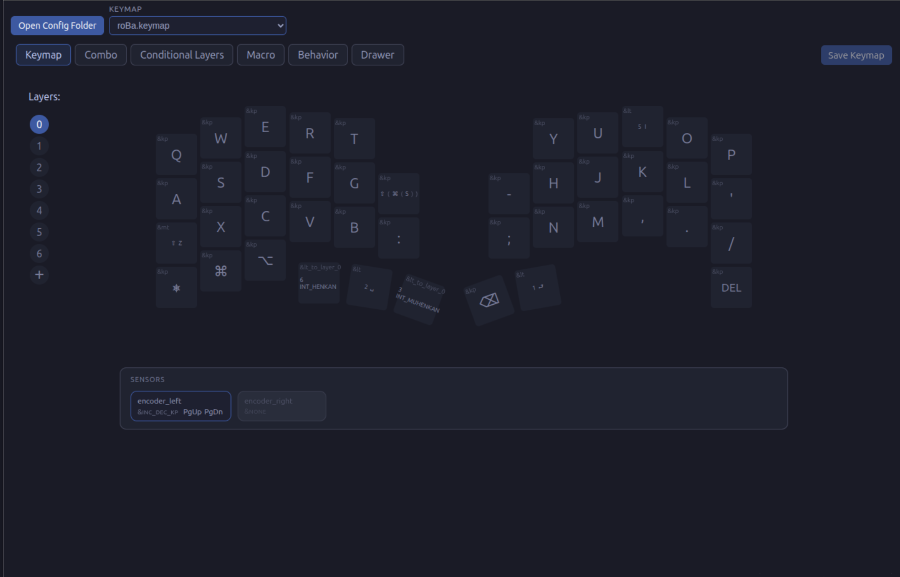
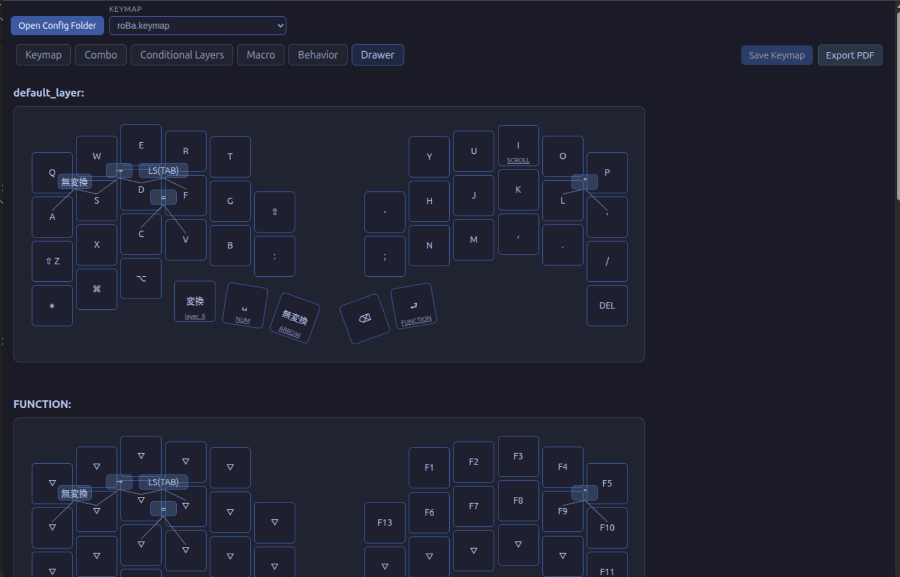

# Keymap Editor (JIS 対応 fork)

ZMK の keymap をブラウザ上で編集するアプリです。
オリジナルは https://github.com/nickcoutsos/keymap-editor で、この fork は元プロジェクトの `main` ブランチ HEAD 時点をベースに調整しています。

JIS レイアウトに存在するキーコードを扱えるようにしていることと、後で見返すための PDF をそのまま出力できることが特徴です。

> 公開先: `https://ihiroky.github.io/keymap-editor/`




---

## はじめに（ZMK を使っている人へ）

このツールは **`.keymap` を読み込んで画面上で編集し、書き戻す** だけのツールです。
ZMK のビルド・ファームウェア生成・`commit` / `push` は行いません。ZMK の知識（レイヤー、behavior、keycode など）があれば、操作はほぼそのまま理解できます。

### このツールでできること

- `.keymap` の読み込みと、キー・レイヤー・Combo・Conditional Layer・Macro・Behavior の編集
- JIS レイアウトのキーコード入力
- 編集内容の確認用 PDF 出力

### このツールがしないこと（重要）

- **ビルド / ファームウェア生成**：ZMK のビルドは別途 `zmk-config` を `push` して GitHub Actions を回してください
- **`commit` / `push`**：保存後は自分で `commit` & `push` する必要があります
- **`.json`（レイアウト定義）の書き換え**：保存対象は `.keymap` のみです
- **コメントや独自マクロの保持**：保存時は元ファイルをテンプレートとして使い、編集した範囲だけを書き換えます。ただし構造を変更したセクション内のコメントなどは失われることがあります（後述）

---

## 事前に用意するもの

### 1. `zmk-config` リポジトリ

自分のキーボード用の `zmk-config-<キーボード名>` リポジトリ（`config` ディレクトリを含むもの）を用意します。

### 2. `<キーボード名>.json`（物理レイアウト定義）

`.keymap` と **同じファイル名** の `.json` が必要です。
これはキーの並び・位置を画面上に描画するための定義で、QMK / Keyboard Layout Editor 由来の形式です。

通常の `zmk-config` には入っていないため、次のいずれかで用意してください。

- 既存の対応済みキーボードの例を参考にする（[レイアウト定義の作り方](https://github.com/nickcoutsos/keymap-editor/wiki/Defining-keyboard-layouts)）
- 本家のサンプルリポジトリ（[keymap-editor-demo-crkbd](https://github.com/nickcoutsos/keymap-editor-demo-crkbd)）の `.json` を参考にする

> `.keymap` と `.json` は、`config` ディレクトリ内で同じ名前（例: `<キーボード名>.keymap` と `<キーボード名>.json`）にしてください。名前が一致しない場合は読み込めません。

### 3. `keys_jp.h`（キーコードを使う behavior を含む場合。実質ほぼ必須）

この fork が生成する keymap は、`&kp` などのキーコードを使う behavior を含むと **選択したキーコードに関わらず** `keys_jp.h` を include します。詳細は「[keys_jp.h について](#keys_jph-について)」を参照してください。

---

## 使い方

### ブラウザで開く

公開先 `https://ihiroky.github.io/keymap-editor/` を開きます。

### 1. config フォルダを選ぶ

`Open Config Folder` ボタンをクリックし、アクセス許可を求められたら承認して、`zmk-config-<キーボード名>/config` ディレクトリを指定します。
`<キーボード名>.keymap` と `<キーボード名>.json` が読み込まれ、編集可能になります。
`config` 内に複数の `.keymap` がある場合は、ファイル名順で先頭のものが自動的に選ばれます。上部の `Keymap` セレクタで切り替えられます。

### 2. キーを編集する

キーをクリックすると編集ペインが開きます。

- **Behavior**：`&kp` や `&mo` などの behavior を選ぶ
- **Parameters**：behavior の引数（レイヤー番号、キーコードなど）を選ぶ
- `Apply` で確定、`Cancel` で破棄、`Discard` でそのキーを保存前の状態に戻す
- ペインのヘッダ右上のハンドルで、ペインをドラッグ移動できます

### 3. 保存する

`Save Keymap` を押すと `.keymap` に保存します。

- Chromium 系：選択した `.keymap` に直接書き戻します
- それ以外：書き込みができないため `.keymap` をダウンロードします（自分で `config` に置き直してください）

保存後、ZMK のビルドを反映させるには **自分で `commit` & `push`** してください。

### 保存時の注意（重要）

保存時は、読み込んだ `.keymap` を丸ごと作り直すのではなく、**元ファイルをテンプレートとして使い、編集した範囲だけを書き換え**ます。
そのため、ファイル全体のコメントや `/ { ... };` の外側にある `#define` などは基本的にそのまま保持されます。

一方で、次のような場合は該当部分を再生成するため、**そのセクション内**のコメントや、ツールが解釈できない記述は失われることがあります。

- レイヤー、Combo、Macro、Behavior、Conditional Layer を追加・削除・名前変更したとき（該当セクションを再生成）
- 解析できない書式の binding がある状態で、そのレイヤーを編集したとき
- 新しい `#include` が必要な behavior を追加したとき（各セクションを再生成）
- リポジトリに `.keymap.template` がある場合（テンプレート運用）：テンプレートから全体を再生成するため、テンプレートに含まれない記述は失われます

保存前のプレビューで元ファイルとの差分を確認でき、「バックアップをダウンロード」で元ファイルを保存できます。心配な場合はプレビューを確認し、必要ならバックアップを取ってください。

---

## 画面の見方

編集画面は上部のタブで切り替えます。

| タブ | 内容 |
| --- | --- |
| Keymap | キー配列そのものの編集 |
| Combo | `combos { ... }` の編集 |
| Conditional Layers | `conditional_layers { ... }` の編集 |
| Macro | `behaviors { ... }` のうち macro 系の編集 |
| Behavior | macro 以外の behavior 定義・override の編集 |
| Drawer | 確認用の一覧表示と PDF 出力 |

補助表示：

- 変更したタブには **ドット** が付きます
- 変更したキー・項目はハイライトされます
- 解決できない binding があるキーには **`!`** マーカーが付きます（`title` にエラー内容）

---

## keys_jp.h について

この fork では、キーコードを使う behavior（`&kp` / `&mt` / `&lt` / `&sk` / `&kt` / `&inc_dec_kp` など）を keymap に含む場合、**選択したキーコードに関わらず**、保存される keymap に `#include "keys_jp.h"` が追加されます。

これは JIS 系キーコードに加えて、この fork 独自のキーコード定義を `keys_jp.h` に持たせているためです。したがって：

- JIS 系キーコードを使わない場合でも、`keys_jp.h` を `zmk-config` 内の `config` ディレクトリに格納してください。
- 配布先：https://github.com/ihiroky/zmk-config-roBa/blob/main/config/keys_jp.h

`keys_jp.h` を配置しないと、ZMK のビルドでインクルードエラーになります。

---

## よくあるつまずき（FAQ）

**Q. `Open Config Folder` しても読み込めない / `.json` が見つからないと言われる**
A. `config` ディレクトリ内に `<キーボード名>.keymap` と **同名の** `<キーボード名>.json` があるか確認してください（大文字小文字も区別されます）。

**Q. 保存したのにキーボードに反映されない**
A. このツールはビルドしません。保存後に `commit` & `push` して GitHub Actions のビルドを回してください。

**Q. 保存したらコメントや `#define` が消えた**
A. 多くの記述は保持されますが、レイヤーや Combo／Macro などの構造を変更した場合や、新しい `#include` が必要になった場合は該当セクションを再生成するため、その中のコメントは失われることがあります。`/ { ... };` の外側の `#define` やコメントは保持されます。「[保存時の注意](#保存時の注意重要)」を参照し、保存前プレビューで差分を確認してください。

**Q. 「Direct file write is unavailable...」と出る**
A. Firefox / Safari など File System Access API 非対応のブラウザです。`.keymap` と `.json` をそれぞれ選択して読み込み、保存はダウンロードになります。

**Q. JIS キーコードを使っていないのに `keys_jp.h` が無いとビルドが失敗する**
A. `&kp` などのキーコードを使う behavior を含むと、選択したキーコードに関わらず `keys_jp.h` が include されます。`config` に `keys_jp.h` を配置してください（「[keys_jp.h について](#keys_jph-について)」参照）。

---

## 対応ブラウザ

- **Chromium 系（推奨）**：File System Access API で `.keymap` を直接読み書き
- **その他（Firefox / Safari など）**：`.keymap` と `.json` を手動で選択して読み込み、保存はダウンロード

## データの扱い

- behavior や keycode などの **定義は、アプリと同じディレクトリに静的ホストした JSON（`<PUBLIC_URL>/zmk-data/*.json`）を HTTP GET で取得** します。API サーバーは不要です。
- ブラウザファイル版では **keymap の読み書きはローカルで完結** し、keymap 自体は外部へ送信されません。

---

## ローカルで動かす・開発する

リポジトリを clone して手元で動かす場合は [running-locally.md](running-locally.md) を参照してください。

### ビルド済みアプリを静的ホストする

API サーバーを使わず、定義データごと手元で静的ホストする場合：

```bash
cd app && PUBLIC_URL=/keymap-editor npm run build && cd ..
npm run serve   # -> http://localhost:8080/keymap-editor/
```

`npm run build` の前に `api/services/zmk/data/*.json` から `app/public/zmk-data/*.json` へ自動同期されます（`npm run sync:zmk-data` で単体実行も可能）。

## ライセンス

This project is available under the MIT license.
The bundled ZMK keycode definitions are also based on MIT-licensed sources.
